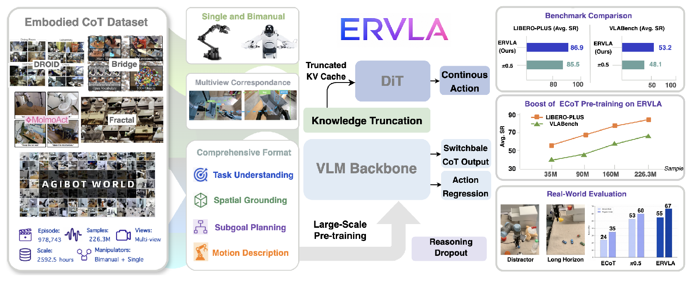
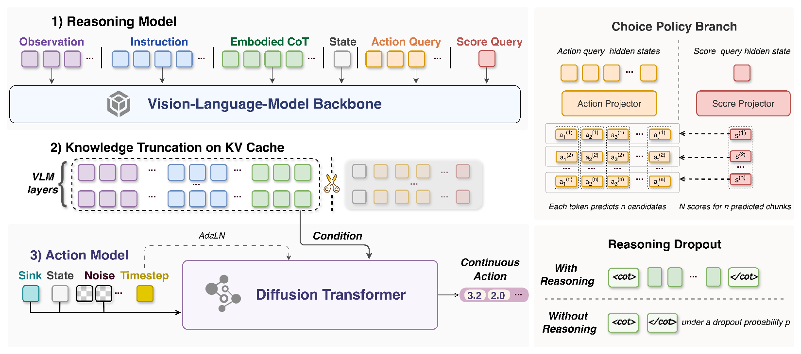
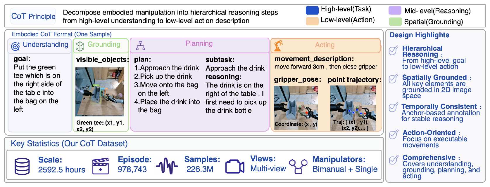
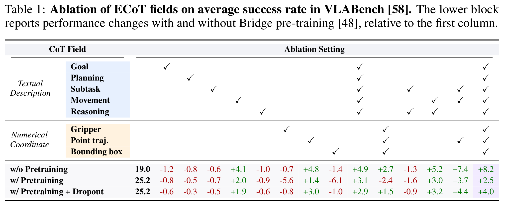
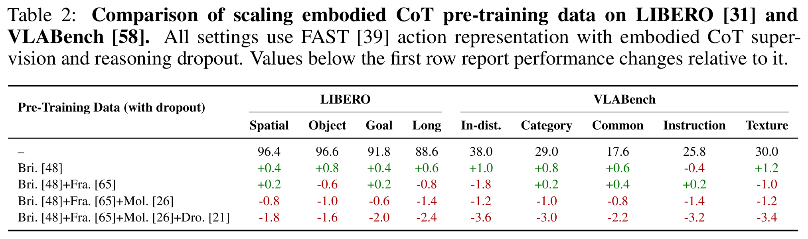
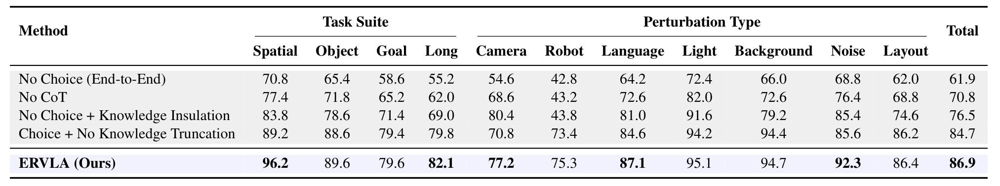
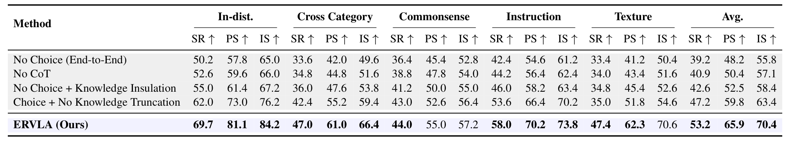

# ERVLA

### Revisiting Embodied Chain-of-Thought for Generalizable Robot Manipulation

Nan Sun, Yuan Zhang, Yongkun Yang, Wentao Zhao, Peiyan Li, Jun Guo, Wenxuan Song, Pengxiang Ding, Runze Suo, Yifei Su, Xin Xiao, Xinghang Li, Huaping Liu

[Paper](https://arxiv.org/abs/2606.03784) · [Project page](https://taoshuaiz.github.io/ERVLA/)

  

ERVLA studies how embodied chain-of-thought (CoT) can make a vision-language-action model more useful for robot control. The central idea is to use structured reasoning to shape the visual-language representation during training, then let the policy predict continuous actions directly at test time. CoT is useful supervision without becoming a required autoregressive step during deployment.

## What is in ERVLA?

- **Structured embodied CoT.** Each trajectory connects task understanding, spatial grounding, subgoal planning, and action-oriented motion descriptions.
- **Reasoning-aware action learning.** A VLM backbone is paired with action-query supervision and a diffusion transformer that generates continuous action chunks.
- **Knowledge truncation.** The action model reads the semantic prefix of the VLM KV cache, avoiding shortcuts through training-only control queries.
- **Reasoning dropout.** CoT is randomly omitted during training, so the same policy can act with or without an explicit reasoning trace.

  

The data format follows the same hierarchy used by the model: a high-level goal is grounded in the observation, expanded into a short plan, and connected to executable motion cues. This keeps language supervision close to the decisions that the robot must make.

  

## Results

The simulation numbers below are reported in the paper. LIBERO-Plus evaluates models post-trained on LIBERO under zero-shot task-suite and perturbation shifts; VLABench measures semantic and distribution-shift generalization across five tracks. `SR` is success rate, `PS` is progress score, and `IS` is intention score.

### LIBERO-Plus: zero-shot transfer

| Method | Spatial | Object | Goal | Long | Camera | Robot | Language | Light | Background | Noise | Layout | Total SR |
| --- | ---: | ---: | ---: | ---: | ---: | ---: | ---: | ---: | ---: | ---: | ---: | ---: |
| ECoT | 31.8 | 27.9 | 30.6 | 8.6 | 0.3 | 26.8 | 40.2 | 42.6 | 16.4 | 10.2 | 36.9 | 24.3 |
| Emma-X | 33.4 | 28.4 | 31.2 | 8.0 | 0.2 | 28.6 | 42.0 | 42.8 | 17.6 | 10.0 | 37.4 | 25.1 |
| OpenVLA-OFT | 84.0 | 66.5 | 63.0 | 66.4 | 56.4 | 31.9 | 79.5 | 88.7 | 93.3 | 75.8 | 74.2 | 69.6 |
| UniVLA | 55.5 | 36.7 | 40.7 | 39.9 | 1.8 | 46.2 | 69.6 | 69.0 | 81.0 | 21.2 | 31.9 | 42.9 |
| WorldVLA | 32.5 | 28.6 | 31.8 | 8.2 | 0.1 | 27.9 | 41.6 | 43.7 | 17.1 | 10.9 | 38.0 | 25.0 |
| π₀ | 60.7 | 61.4 | 44.9 | 48.4 | 13.8 | 6.0 | 58.8 | 85.0 | 81.4 | 79.0 | 68.8 | 53.6 |
| π₀-FAST | 74.4 | 72.7 | 57.6 | 43.4 | 65.1 | 21.6 | 61.0 | 73.2 | 73.2 | 74.4 | 68.8 | 61.6 |
| Spatial Forcing | 52.9 | 31.0 | 28.2 | 5.4 | 20.1 | 13.4 | 40.9 | 29.1 | 33.4 | 25.7 | 39.3 | 29.1 |
| PokeVLA | 85.4 | 81.8 | 77.6 | 72.7 | 84.7 | 46.1 | 84.8 | 94.6 | 82.6 | 89.8 | 77.2 | 79.3 |
| π₀.₅ | 90.4 | 89.9 | 81.0 | 80.8 | 71.7 | 75.5 | 85.9 | 96.1 | 95.7 | 86.4 | 87.5 | 85.5 |
| No Choice (End-to-End) | 70.8 | 65.4 | 58.6 | 55.2 | 54.6 | 42.8 | 64.2 | 72.4 | 66.0 | 68.8 | 62.0 | 61.9 |
| No CoT | 77.4 | 71.8 | 65.2 | 62.0 | 68.6 | 43.2 | 72.6 | 82.0 | 72.6 | 76.4 | 68.8 | 70.8 |
| No Choice + Knowledge Insulation | 83.8 | 78.6 | 71.4 | 69.0 | 80.4 | 43.8 | 81.0 | 91.6 | 79.2 | 85.4 | 74.6 | 76.5 |
| Choice + No Knowledge Truncation | 89.2 | 88.6 | 79.4 | 79.8 | 70.8 | 73.4 | 84.6 | 94.2 | 94.4 | 85.6 | 86.2 | 84.7 |
| **ERVLA (Ours)** | **96.2** | 89.6 | 79.6 | **82.1** | 77.2 | 75.3 | **87.1** | 95.1 | 94.7 | **92.3** | 86.4 | **86.9** |

The first ten rows are external baselines. The final five rows are ERVLA design comparisons: removing the choice policy, removing CoT, blocking action-to-VLM feedback, or removing knowledge truncation each lowers the total score.

### VLABench: semantic and distribution shifts

Each cell is `SR / PS / IS`; `—` denotes an unreported result. The last column gives the average reported in the paper.

| Method | In-dist. | Cross-category | Commonsense | Instruction | Texture | Average |
| --- | --- | --- | --- | --- | --- | --- |
| π₀ | 47.0 / 62.7 / 67.8 | 21.2 / 33.6 / 44.0 | 29.1 / 43.0 / 54.9 | 17.3 / 38.7 / 58.0 | 32.2 / 42.5 / 50.6 | 29.4 / 44.1 / 55.0 |
| π₀-FAST | 56.2 / 66.8 / 72.4 | 31.0 / 38.2 / 47.8 | 38.0 / 48.6 / 56.8 | 35.0 / 45.0 / 59.4 | 39.0 / 49.0 / 56.8 | 39.8 / 49.5 / 58.6 |
| X-VLA | — / 67.8 / — | — / 25.1 / — | — / 48.2 / — | — / 63.1 / — | — / — / — | — / 51.1 / — |
| ACoT-VLA | — / 66.1 / 79.8 | — / 38.9 / 54.1 | — / 37.8 / 52.3 | — / 39.6 / 56.8 | — / 54.6 / 74.6 | — / 47.4 / 63.5 |
| π₀.₅ | 65.4 / 77.8 / 80.4 | 38.2 / 49.7 / 52.0 | 43.9 / 57.3 / 60.0 | 48.2 / 64.2 / 67.0 | 44.9 / 62.3 / 65.0 | 48.1 / 62.3 / 64.9 |
| No Choice (End-to-End) | 50.2 / 57.8 / 65.0 | 33.6 / 42.0 / 49.6 | 36.4 / 45.4 / 52.8 | 42.4 / 54.6 / 61.2 | 33.4 / 41.2 / 50.4 | 39.2 / 48.2 / 55.8 |
| No CoT | 52.6 / 59.6 / 66.0 | 34.8 / 44.8 / 51.6 | 38.8 / 47.8 / 54.0 | 44.2 / 56.4 / 62.4 | 34.0 / 43.4 / 51.6 | 40.9 / 50.4 / 57.1 |
| No Choice + Knowledge Insulation | 55.0 / 61.4 / 67.2 | 36.0 / 47.6 / 53.8 | 41.2 / 50.0 / 55.0 | 46.0 / 58.2 / 63.4 | 34.8 / 45.4 / 52.6 | 42.6 / 52.5 / 58.4 |
| Choice + No Knowledge Truncation | 62.0 / 73.0 / 76.2 | 42.4 / 55.2 / 59.4 | 43.0 / 52.6 / 56.4 | 53.6 / 66.4 / 70.2 | 35.0 / 51.8 / 54.6 | 47.2 / 59.8 / 63.4 |
| **ERVLA (Ours)** | **69.7 / 81.1 / 84.2** | **47.0 / 61.0 / 66.4** | **44.0 / 55.0 / 57.2** | **58.0 / 70.2 / 73.8** | **47.4 / 62.3 / 70.6** | **53.2 / 65.9 / 70.4** |

## Ablations and scaling

### Which CoT fields help?

Table 1 evaluates individual and combined fields on VLABench with a fixed autoregressive CoT+FAST interface. The first numeric column gives average success rates (%); subsequent columns show changes in percentage points from the corresponding baseline. Pre-training uses Bridge.

Without pre-training, the baseline is 19.0 average success. Action-oriented fields are the most useful: Movement gives **+4.1**, Point trajectory **+4.8**, Movement + Reasoning **+5.2**, and Subtask + Movement + Point trajectory **+7.4**. With Bridge pre-training, noisy coordinate supervision can hurt: Gripper and Bounding box change performance by **−5.6** and **−6.1**. Reasoning dropout reduces these drops to **−0.8** and **−1.0**, while preserving the gain from Point trajectory (**+3.0**).

### Does more CoT pre-training always help?

Table 2 reports LIBERO and VLABench changes relative to the no-extra-pre-training row. All settings use FAST actions, embodied CoT supervision, and reasoning dropout.

The scaling study is a useful qualification: adding more explicit CoT to an autoregressive action-token model is not automatically beneficial. In the paper, the final ERVLA recipe addresses this failure mode by using CoT as representation supervision, choice-policy action shaping, knowledge-truncated conditioning, and continuous action generation.

### Choice policy and knowledge truncation

The ablation rows from Tables 3 and 4 compare the choice policy and knowledge truncation on both benchmarks.

**LIBERO-Plus (Table 3)**

**VLABench (Table 4)**

## Installation and quick start

### 1. Create a Python environment

~~~bash
conda create -n ervla python=3.12 -y
conda activate ervla
pip install --no-build-isolation -r requirements.txt
~~~

### 2. Prepare training data

Post-training reads JSON+video episodes and a separate directory of CoT
annotations produced by the command below. Each episode JSON is paired with
`<chunk>/<episode>_ecot.json` under the CoT directory:

~~~text
cot/
  chunk-0000/
    episode_0000000_ecot.json
    episode_0000001_ecot.json
~~~

### 3. Generate CoT annotations

~~~bash
export COT_API_BASE="<CHAT_API_BASE_URL>"  # e.g. an endpoint ending in /v1
export COT_API_KEY="<API_KEY>"
export COT_MODEL="<VISION_LANGUAGE_MODEL>"
~~~

#### VLABench and LIBERO

~~~bash
# VLABench
bash scripts/annotate_cot_from_raw.sh \
  --dataset vlabench \
  --data-root path/to/vlabench/json \
  --output-root outputs/cot/vlabench \
  --source-root path/to/vlabench/source-hdf5 \
  --replay-index path/to/vlabench/replay-index.json \
  --simulator-root path/to/VLABench \
  --simulator-python path/to/simulation-env/bin/python

# LIBERO: run once per suite
bash scripts/annotate_cot_from_raw.sh \
  --dataset libero \
  --data-root path/to/libero-suite/json \
  --output-root outputs/cot/libero-suite \
  --source-root path/to/libero/source-hdf5 \
  --replay-index path/to/libero/replay-index.json \
  --assets-root path/to/libero/assets \
  --simulator-python path/to/simulation-env/bin/python
~~~

#### DROID, Bridge, Fractal, and MolmoAct

~~~bash
DATASET=molmoact  # droid, bridge, fractal, or molmoact
bash scripts/annotate_cot_from_raw.sh \
  --dataset "$DATASET" \
  --data-root path/to/dataset/json \
  --output-root "outputs/cot/$DATASET" \
  --calibration-root path/to/dataset/camera-calibrations \
  --detector-model path/to/llmdet-checkpoint
~~~

### 4. Train from a Hugging Face checkpoint

~~~bash
# VLABench
bash scripts/train_vlabench_cot_hf_local.sh \
  --nodes 1 --gpus 8 \
  --pretrained-model path/to/pretrained-hf \
  --data-path path/to/vlabench/train/data \
  --cot-path path/to/vlabench/cot \
  --output-dir outputs/vlabench_cot \
  --max-steps 1000

# LIBERO
bash scripts/train_libero_cot_hf_local.sh \
  --nodes 1 --gpus 8 \
  --pretrained-model path/to/pretrained-hf \
  --data-root path/to/libero/data2 \
  --cot-root path/to/libero/cot \
  --output-dir outputs/libero_cot \
  --max-steps 1000
~~~
 

### 5. Evaluate a checkpoint

The launchers start the HF inference servers and dispatch the benchmark workers. Replace the paths below with your checkpoint, simulator checkout, and Python executables.

#### VLABench

~~~bash
export VLABENCH_ROOT=path/to/VLABench
export PY_BIN=path/to/vlabench-env/bin/python
export SERVER_PY_BIN=path/to/ervla-env/bin/python

bash benchmark/vlabench/choice/run_vlabench_choice_dynamic.sh \
  --model-name ervla-opensource-vlabench \
  --hf-model-path path/to/hf/ervla-opensource-vlabench \
  --launch-servers 1 \
  --num-gpus 2 \
  --servers-per-gpu 1 \
  --num-workers 2 \
  --base-port 12086 \
  --n-ep 50 \
  --vis 0 \
  --save-dir results/vlabench/ervla-opensource-vlabench
~~~

#### LIBERO-Plus

~~~bash
export LIBEROPLUS_ROOT=path/to/LIBERO-plus
export LIBERO_ASSETS_ROOT=path/to/LIBERO-plus/libero/libero/assets
export PY_BIN=path/to/liberoplus-env/bin/python
export SERVER_PY_BIN=path/to/ervla-env/bin/python

bash benchmark/liberoplus/run_liberoplus_dynamic.sh \
  --model-path path/to/hf/ervla-opensource-liberoplus \
  --model-name ervla-opensource-liberoplus \
  --num-gpus 2 \
  --servers-per-gpu 1 \
  --num-workers 2 \
  --base-port 10086 \
  --launch-servers 1 \
  --suites "libero_spatial libero_object libero_goal libero_10" \
  --perturbations sensor_noise \
  --episodes-per-task 1 \
  --vis 0 \
  --resume 1 \
  --save-dir results/libero_plus/ervla-opensource-liberoplus
~~~

## Citation

~~~bibtex
@article{sun2026ervla,
  title   = {Revisiting Embodied Chain-of-Thought for Generalizable Robot Manipulation},
  author  = {Sun, Nan and Zhang, Yuan and Yang, Yongkun and Zhao, Wentao and Li, Peiyan and Guo, Jun and Song, Wenxuan and Ding, Pengxiang and Suo, Runze and Su, Yifei and Xiao, Xin and Li, Xinghang and Liu, Huaping},
  journal = {arXiv preprint arXiv:2606.03784},
  year    = {2026}
}
~~~

Figures and results are from the paper linked above.
